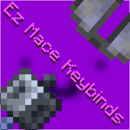

<div align="center">



# Ez Mace Keybinds

[


](https://modrinth.com/mods?e=client)
[


](https://fabricmc.net/)
[


](https://quiltmc.org/)
[


](https://adoptium.net/)
[


](LICENSE)

<!-- Add your Modrinth / CurseForge / Discord badges here once the pages exist -->

</div>

## 🤔 What does this mod do?

Ez Mace Keybinds is a client-side Fabric *(Quilt should also work)* mod that turns the fiddly hotbar juggling behind mace and elytra PvP into single keypresses.

Struggling to do Mace techniques? This could be your chance to get good like Mace PvPers! Air pot, swap between elytra and chestplate, fire fireworks, pearl catch, throw pearls, use wind charges and lunge swap, all with just keybinds.

All keybinds are **unbound by default**, so nothing interferes with your controls until you set them up.

## Featuring:

- [💨](#-trigger-air-pot) Air Pot: splash potions and a wind charge in one press
- [🪂](#-elytra--armor-swap) Elytra / Armor Swap with a Swap/Revert mode toggle
- [🎆](#-trigger-firework--trigger-wind-charge) Trigger Firework and Trigger Wind Charge
- [🟣](#-pearl-catch--trigger-pearl) Pearl Catch and Trigger Pearl
- [🔱](#-lunge-swap) Lunge Swap (1.1 only): swap to your spear, attack, swap back

## Compatibility

| Folder | Minecraft | Mod version | Lunge Swap | Java |
|--------|-----------|-------------|------------|------|
| [`versions/1.0-1.21.x`](versions/1.0-1.21.x) | 1.21 – 1.21.11 | 1.0 | No | 21+ |
| [`versions/1.1-1.21.11`](versions/1.1-1.21.11) | 1.21.11 only | 1.1 | Yes | 21+ |
| [`versions/1.1-26.x`](versions/1.1-26.x) | 26.x (>=26.1 <27) | 1.1 | Yes | **25+** |

- **Fabric + Fabric API:** supported
- **Quilt:** should work through Fabric compatibility, but is not fully tested
- **Forge / NeoForge:** not supported
- **26.x builds:** compiled against 26.2. 26.1 and 26.3 are untested
- **Other mods:** the mod uses no mixins, so it doesn't patch game code and isn't expected to conflict with other mods (not exhaustively tested)

<div align="center">
<details><summary><h1>Keybind guides [click to open]</h1></summary>

<div align="left">

> **Important:** every item the mod uses must be in your **hotbar** (slots 1–9). The mod looks for items there. If an item is missing, the keybind does nothing.

## 💨 Trigger Air Pot

- Needs a **wind charge** in your hotbar. Without one, nothing happens.
- Throws a splash potion of **swiftness**, **healing** and **strength** (any of them you have in the hotbar), then uses the wind charge.
- Switches back to your original hotbar slot afterwards.

## 🪂 Elytra / Armor Swap

- If you're wearing an elytra, it swaps to a chestplate from your hotbar. Otherwise it swaps to an elytra from your hotbar.
- **Elytra Armor Swap/Revert Mode** is a separate keybind that toggles between **Swap** and **Revert** mode. An action-bar message shows which mode you switched to. Revert is the default.

## 🎆 Trigger Firework / Trigger Wind Charge

- Uses a firework rocket or wind charge from your main hand, your off hand, or the first matching hotbar slot.
- If it had to switch slots, it switches back afterwards.

## 🟣 Pearl Catch / Trigger Pearl

- **Trigger Pearl:** selects an ender pearl in your hotbar, throws it, then switches back.
- **Trigger Pearl Catch:** needs both an **ender pearl** and a **wind charge** in your hotbar. Throws the pearl, then uses the wind charge, then switches back.

## 🔱 Lunge Swap

- **1.1 builds only.**
- Swaps to the spear in your hotbar, attacks, then switches back to your original slot.
- If you're already holding a spear, it just attacks.

## ⏱️ Good to know

- While one sequence is running, the other keybinds are ignored until it finishes, so you can't overlap them by accident.
- There is no config file. Everything is set in the Controls menu.

</div>

</details>
</div>

## Setting up your keybinds

1. Open **Options > Controls > Key Binds**.
2. Scroll to the **Ez Mace Keybinds** category.
3. Bind each action to the key you want.

Keybinds available: Trigger Firework, Trigger Elytra/Armor Swap, Elytra Armor Swap/Revert Mode, Trigger Wind Charge, Trigger Pearl Catch, Trigger Air Pot, Trigger Pearl and Trigger Lunge Swap (1.1 only).

## Installing

1. Install [Fabric Loader](https://fabricmc.net/use/) (0.19.3 or newer for the 26.x build) and [Fabric API](https://modrinth.com/mod/fabric-api).
2. Make sure you're on the right Java version (25+ for 26.x, 21+ for 1.21.x).
3. Drop the mod jar into your `mods` folder.

## FAQ

> The keybind does nothing!

- Check that the keybind is actually set (they're unbound by default).
- Check that the items it needs are in your **hotbar**, not deeper in your inventory.
- Check that you're using the build that matches your Minecraft version.

> Does it work on Quilt?

- It should, since Quilt loads Fabric mods, and you'd use Fabric API. It hasn't been fully tested on Quilt, so please report any problems.

> Does it work on Forge or NeoForge?

- No. It's a Fabric mod and has no Forge or NeoForge build.

> Is this allowed on servers?

- The mod is client-side only, so servers don't need it. But it automates item swapping and use in timed sequences, so check a server's rules before using it on multiplayer.

> Can you port it to another Minecraft version?

- Open a **Version Port** issue. Versions lower than 1.21 won't be ported.

> I found a bug / I have an idea!

- Use [**New issue**](https://github.com/Brenthgaming123/EzMaceKeybinds/issues/new/choose) and pick Bug report, Feature, Version Port or Message. For a bug, include your Minecraft version, loader, mod version and your `latest.log` or crash report.

## Building from source

Each folder under `versions/` is a standalone Gradle project.

```bash
cd versions/1.1-26.x   # or 1.0-1.21.x / 1.1-1.21.11
gradle clean build
# JAR -> build/libs/
```

| Version | Java | Gradle |
|---------|------|--------|
| 1.0 / 1.1 (1.21) | 21+ | 8.14+ / 9.x |
| 1.1 (26.x) | **25+** | **9.8+** |

## Changelog

See [CHANGELOG.md](CHANGELOG.md).

## Credits

Made by **Timmy** and **Brenthgaming123**.

## License

This mod is under the [MIT License](LICENSE).
